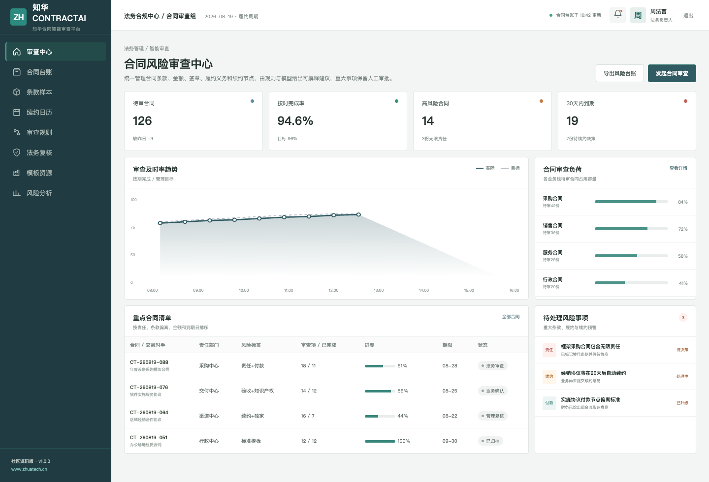
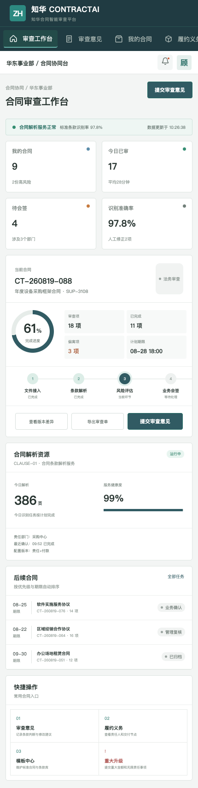

# Zhuatech ContractAI｜知华合同智能审查平台


## 本次升级：履约保函金额与到期衔接

检查有效保函金额是否达到合同要求，且保函到期不早于履约结束加缓冲天数，失效保函不计覆盖。不自动签约或释放保函。

新增已认证的结构化录入工作台（`/operations.html`），支持批量核算、逐条结果依据、分级复核和CSV/完整JSON导出。结果由真实后端算法计算，不是预置演示数字。所有数值精确传递，不调用外部模型。

这是**只读核算**：不写库、不审批、不自动执行财务、签署、销毁或设备控制。输入条件满足不是执行授权。[算法、输入边界与接口说明](docs/OPERATIONS-REVIEW.md)。
## 本次功能更新：合同履约期限台账计算

基于明确的到期日与提前提醒天数生成逾期、临期、正常、完成状态及逾期天数，按日期稳定排序；不自动通知或变更合同。 登录后从「业务计算工具」进入，支持真实后端校验与结果导出。详见[接口、示例与边界说明](docs/AI_BUSINESS_UPGRADE_20261023.md)。本次不改变既有许可及联系方式。

[简体中文](README.md) | [English](README.en.md)

面向中小企业法务、采购、销售和项目交付团队的合同全生命周期社区版。系统对必备条款、无限责任、付款偏离、重大金额、自动续约与到期日进行可解释评分，不替代法务人员作出最终决定。

[知华科技官网](https://www.zhuatech.cn/) · 上海如静知华信息科技有限公司 · Java 包名 `cn.zhuatech.contractai`



## 一条合同如何被处理

`文件接入 → 条款解析 → 风险评估 → 业务会签 → 签署归档 → 履约/续约提醒`

- 条款比对：识别必备、替代与禁止条款，展示原文位置和风险解释。
- 风险路由：重大金额、无限责任和非标准付款自动进入相应审批队列。
- 履约跟踪：维护交付、付款、保密、终止和续约义务。
- 人工门禁：所有模型结果都是建议，签署决定由授权业务与法务人员完成。
- 审计留痕：保存版本差异、规则版本、审查意见与会签记录。

### 经办人移动工作台



## 技术与运行

后端采用 Java 21、Spring Boot、Spring Security/JWT、JPA、Flyway；前端采用 Vue 3、Vite、Pinia；生产数据库使用 MySQL 8，测试使用 H2。

```bash
docker compose up --build
```

打开 `http://localhost:5173`。演示账号：`admin / Demo@2026`、`operator / Demo@2026`。核心接口：`POST /api/ai/contract/analyze`。更多说明见 [API](docs/api.md)、[架构](docs/architecture.md)和[数据库](docs/database.md)。

## 使用边界与服务

本工程仅限个人非商业学习、研究和技术交流，**不得商用**。企业内部使用、生产部署、SaaS、实施交付、收费服务、品牌替换或商业再发行，须事先取得上海如静知华信息科技有限公司书面授权，详见 [LICENSE](LICENSE)。

需要合同管理、法务数字化、AI 私有化、软件外包、FDE 或深度开发定制，请访问[知华科技官网](https://www.zhuatech.cn/)或扫码咨询：

| 微信咨询一 | 微信咨询二 |
| --- | --- |
|  |  |

Copyright © 2026 上海如静知华信息科技有限公司

## 企业级合同 AI 审查发布

`POST /api/enterprise/contractai/contract-review-publication` 对审查结论执行条款追溯、法域、保密、隐私、重大风险升级与法务批准门禁。

## 合同义务履约与续约监控

`POST /api/enterprise/contractai/obligation-execution` 将付款、交付、报告、合规和续约义务转换为可执行台账，计算到期/逾期状态与暴露金额，并处理履约证据、例外审批、交易对手制裁、法务保全和自动续约通知期。详见[义务履约说明](docs/ENTERPRISE_OBLIGATION_EXECUTION.md)。

新增 `POST /api/enterprise/contractai/contract-review-publication`，覆盖引用、条款追溯、法域、保密、个人信息、风险升级、法务复核和审计，返回 `PUBLISH / COUNSEL_REVIEW / BLOCKED`。详见 [审查发布说明](docs/ENTERPRISE_REVIEW_PUBLICATION.md)。

## 合同组合风险监控

`POST /api/enterprise/contractai/portfolio-risk` 汇总交易对手敞口，检查单一交易对手集中度、高风险法域、制裁命中和自动续约通知窗口，输出 `MONITOR / REVIEW / BLOCKED`，补齐单份合同之外的组合风险视角。
